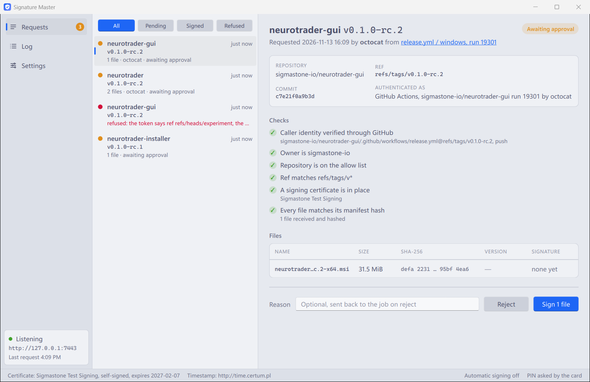

# Signature Master

[](https://github.com/sigmastone-io/signature-master/actions/workflows/build.yml)
[](LICENSE)

A signing desk for code signing certificates that cannot be copied into CI. Signature Master runs
on the Windows machine where the certificate is usable, listens for release jobs over a small
REST API, and
signs the files they send with `signtool`, once a person at the desk has said yes, or on its own
for requests that prove where they come from.

<picture>
  <source media="(prefers-color-scheme: dark)" srcset="doc/screenshots/requests-dark.png">
  
</picture>

## Why

A code signing key today lives on a smart card, a USB token or a CA's cloud signing service
(Certum SimplySign, for one), and none of them can be copied into a CI secret. Nor should they
be: a credential in CI is the ability to sign in anybody's hands who can read it. That leaves a
release pipeline with a gap at the one step that needs the key. Signature Master closes it
without moving the key:

- the key stays usable on one desktop only, in the session of the person who owns it: the card
  plugged in there, or the cloud signing client logged in there, where its own dialogs can
  appear;
- a release job uploads its unsigned files to the desk, waits, and downloads the signed copies;
- the job proves which repository, ref, commit and run it is with its GitHub Actions OIDC token,
  bound to the exact request it sends, so a request cannot be forged or replayed;
- a person approves each request on screen, or, when they choose to, the desk signs requests
  whose every check passed without asking.

The desk never holds the key or the credential that unlocks it. It hands `signtool` a
thumbprint, and the card's middleware or the cloud signing client does the rest.

## Features

- **Requests** with everything a decision needs: repository, ref, commit, workflow, run and actor;
  six checks (caller identity, owner, repository, ref, certificate, file hashes); each file with
  its size, SHA-256 and version. Sign or Reject, with a reason the job sees.
- **GitHub Actions OIDC authentication.** The token's audience is the SHA-256 of the request body,
  and its `repository`, `ref`, `sha` and `run_id` must match the manifest. A request without a
  token is listed as *unverified*: a person can still approve it, it is never signed
  automatically.
- **Allow lists** for the owner, the repositories and the refs that may ask. None names an owner
  or a repository out of the box; until they are set, those checks are unverified, so a person
  can approve a request and nothing is signed automatically. The ref pattern starts as
  `refs/tags/v*`.
- **Signing with `signtool`**: SHA-256 digests, an RFC 3161 timestamp, a check that the signed copy
  carries the chosen certificate, and `signtool verify /pa` for a publicly trusted certificate.
- **Automatic signing**, off by default, for verified requests whose every check passed.
- **An append-only signature log**, one line per file and outcome, with a viewer and CSV export.
- **A tray icon** with notifications for new requests, so the desk can live out of sight.
- **A test certificate** made in one click, for trying the whole path before the real
  certificate is issued.
- Light and dark themes following Windows.

More pictures: [doc/screenshots.md](doc/screenshots.md).

## Requirements

- Windows 10 or 11, x64.
- `signtool.exe` from the Windows SDK ("Windows SDK Signing Tools for Desktop Apps"). The desk
  finds it under `C:\Program Files (x86)\Windows Kits\10\bin`; another location can be set in
  Settings.
- A code signing certificate in the current user's personal store (`Cert:\CurrentUser\My`). A
  smart card or token shows up there once its vendor's middleware is installed, and the card's own
  PIN dialog asks for the PIN when a file is signed. A cloud certificate shows up there through
  its vendor's client: Certum's SimplySign Desktop presents it as a virtual smart card while a
  session is open (see [Using Certum SimplySign](#using-certum-simplysign)).
- The issuing CA's intermediate certificate in `Cert:\CurrentUser\CA`, so that `signtool` puts it
  in every signature and a machine that lacks it can still build the chain.
- A network path from the release job's runner to the desk: the LAN (TCP 7443 by default), or a
  tunnel that gives the desk an HTTPS address when the runners are elsewhere (see
  [Reaching the desk from elsewhere](#reaching-the-desk-from-elsewhere)). The desk itself speaks
  plain HTTP; see [Security model](#security-model).

## Install

Download `signature-master-<version>-x64.msi` from the
[latest release](https://github.com/sigmastone-io/signature-master/releases) and run it. It
installs per machine into `C:\Program Files\Signature Master` with a Start menu shortcut, and
closes a running desk before an upgrade.

**The MSI is not code-signed yet.** SmartScreen warns when it is opened ("Windows protected your
PC": More info, Run anyway). Each release carries a `.sha256` file; check the download against it
first:

```powershell
(Get-FileHash .\signature-master-0.1.0-x64.msi -Algorithm SHA256).Hash
Get-Content .\signature-master-0.1.0-x64.msi.sha256
```

## Quick start

1. Start Signature Master from the Start menu. The window opens on Requests; closing it hides the
   desk in the tray, and only the tray menu quits it.
2. In **Settings, Certificate**, choose your code signing certificate from the user store. To try
   things first, **Make a test certificate** creates a self-signed one
   (`CN=Sigmastone Test Signing`, three months). It is trusted by nobody: never publish anything
   signed with it.
3. In **Settings, Who may ask**, set the GitHub owner, the repositories and the ref pattern that may
   send requests. Automatic signing needs all three set.
4. In **Settings, Listening**, check the address and port (`0.0.0.0:7443`), and allow the desk
   through Windows Firewall when Windows asks.
5. From another machine, check that the desk answers:

   ```powershell
   .\scripts\Test-SigningDesk.ps1 -Desk http://192.0.2.10:7443
   ```

**The tray icon on Windows 11.** Windows 11 files a new tray icon among the hidden ones. If the
taskbar's hidden-icon menu is switched off, the icon is not visible at all until it is switched on
once by hand: Settings, Personalization, Taskbar, Other system tray icons, Signature Master.
Windows remembers that per executable path, so it is needed once per installation. The desk also
marks its own entry as promoted, which Windows honours on some builds.

## Calling it from a release job

Two PowerShell scripts under [`scripts/`](scripts) are the job side; there is no client library.
Copy them into the repository that releases, or fetch them at a pinned tag.

```yaml
jobs:
  package:
    runs-on: [ self-hosted, Windows ]   # a runner that can reach the desk
    permissions:
      contents: read
      id-token: write                   # the OIDC token that proves the run
    steps:
      # ... build the files to sign ...
      - name: Sign
        shell: pwsh
        env:
          SIGNING_DESK: ${{ vars.SIGNING_DESK }}       # http://192.0.2.10:7443 or https://sign.example.com
          SIGNING_THUMBPRINT: ${{ vars.SIGNING_THUMBPRINT }}
        run: |
          ./scripts/Test-SigningDesk.ps1
          ./scripts/Request-Signature.ps1 -Files build\msi\product-1.2.0-x64.msi
```

`Request-Signature.ps1` builds the manifest from the `GITHUB_*` variables, asks GitHub for an ID
token bound to it, opens the request, uploads the files and waits (20 minutes by default) for the
desk. It then fetches each signed copy, checks the signer's thumbprint, the signature status and
the timestamp, and only then replaces the originals in place. Any other outcome fails the job with
the desk's reason. Outside Actions it sends no token and the desk lists the request as
unverified, which is how a file is re-signed by hand. `-AllowUntrustedSigner` accepts the
self-signed test certificate and is never for a release.

The routes, the manifest, the request and its states are in
[doc/02. rest-api.md](doc/02.%20rest-api.md).

## Security model

- **The desk never touches the key.** It calls `signtool` with the certificate's thumbprint; the
  private key is used by the card's middleware or the cloud signing client and is never read,
  exported or sent by the desk. With a cloud certificate the files' digests go to the vendor's
  service to be signed; that is the vendor's design, not the desk's.
- **Every request says who sent it, and the token proves it.** A GitHub Actions ID token is
  verified against GitHub's published keys: issuer, expiry, the audience equal to the SHA-256 of
  the body received, `repository_owner` equal to the allowed owner, and `repository`, `ref`, `sha`
  and `run_id` equal to the manifest. A token that fails any of these refuses the request.
- **What the job sends is what gets signed.** Each uploaded file must match the size and SHA-256
  in the manifest; a mismatch refuses the whole request.
- **A person decides unless they chose otherwise.** Automatic signing is off by default and never
  applies to an unverified request or one with a failed check.
- **The job checks what comes back.** `Request-Signature.ps1` verifies the signer, the status and
  the timestamp before it replaces anything.
- **Everything is recorded.** The signature log is append-only JSON lines in
  `%LOCALAPPDATA%\Sigmastone\SignatureMaster\signatures.log`.
- **Plain HTTP at the desk; TLS is the tunnel's.** The token binding means a request cannot be
  altered in flight without being refused, but on the LAN the files travel unencrypted. Never
  forward a port to the desk; to reach it from elsewhere, put a tunnel in front that terminates
  TLS and forwards to the desk on the same machine.
- **Reachable from outside means anyone may ask.** Requests from strangers are refused when they
  fail the owner, repository or ref rules, and listed as unverified when they carry no token;
  only a person approves an unverified request. Set the allow lists before exposing the desk.
- **The PIN or login.** A card's own dialog asks for its PIN, and a cloud client asks for its own
  login; the desk sees neither. Keeping a card's PIN in Windows Credential Manager, so automatic
  signing can run unattended with a card, is planned and not built; its setting is disabled. It
  has nothing to keep with SimplySign, whose login is a one-time token.

## Reaching the desk from elsewhere

When the release runners are not on the desk's network, give the desk an HTTPS address through a
tunnel that dials out from the desk's machine, so nothing listens on the Internet and no router
or firewall changes. With Cloudflare Tunnel, for example:

1. Create a tunnel and a public hostname for it in a zone on the account, with the service
   `http://127.0.0.1:7443`.
2. Install `cloudflared` on the desk's machine and run the tunnel as a Windows service
   (`cloudflared service install <token>` from an elevated shell).
3. Check from anywhere: `.\scripts\Test-SigningDesk.ps1 -Desk https://sign.example.com`.
4. Give the release jobs that address as `SIGNING_DESK`.

With the tunnel on the same machine the desk can listen on `127.0.0.1` alone. Cloudflare's free
plan caps a request body at 100 MB, which is the largest file the desk can take through it;
the desk itself takes files up to 512 MiB.

## Using Certum SimplySign

Sigmastone signs with a Certum code signing certificate held in Certum's cloud. The setup on the
desk's machine, once:

1. Activate the SimplySign mobile app with the code from Certum. It generates the one-time tokens
   SimplySign Desktop logs in with.
2. Install SimplySign Desktop from Certum and log in from its tray icon with the account's e-mail
   address and a token from the app. The certificate appears in `Cert:\CurrentUser\My`:

   ```powershell
   Get-ChildItem Cert:\CurrentUser\My -CodeSigningCert | Format-List Subject, Issuer, Thumbprint, HasPrivateKey
   ```

3. Import the intermediate certificate Certum supplies with it (`Certum Code Signing 2021 CA`) into
   `Cert:\CurrentUser\CA`. The roots above it are already trusted by Windows; do not import them.

   ```powershell
   Import-Certificate -FilePath '.\Certum Code Signing 2021 CA.cer' -CertStoreLocation Cert:\CurrentUser\CA
   ```

4. In the desk's Settings, pick the certificate. The timestamp server default,
   `http://time.certum.pl`, is Certum's.
5. Give the release jobs the new thumbprint (`SIGNING_THUMBPRINT`) and drop
   `-AllowUntrustedSigner`, which exists only for the test certificate.

The desk can sign only while SimplySign Desktop has a session open. A session ends on its own
after a while without use; a request that arrives afterwards fails at `signtool` until the session
is opened again with a fresh token, and can then be signed again from a new request.

## Building from source

The desk is Qt 6 (QML and C++), built with CMake and Ninja. Every dependency, Qt included, comes
through [vcpkg](https://vcpkg.io) in manifest mode (`vcpkg.json`). You need:

- Visual Studio 2022 or later (or its Build Tools) with the C++ workload; CMake and Ninja ship
  with it.
- A vcpkg checkout that contains the `builtin-baseline` commit in `vcpkg.json`, with `VCPKG_ROOT`
  pointing at it. The first configure builds Qt from source, which takes an hour or more; later
  ones come from vcpkg's binary cache.

From a Visual Studio developer PowerShell:

```powershell
cmake --preset dev
cmake --build --preset dev
ctest --test-dir build\dev --output-on-failure
build\dev\signature-master.exe
```

`dev` is RelWithDebInfo with a console; `debug` and `release` exist too. Each build runs
`windeployqt`, so the executable runs straight from the build directory. A `CMakeUserPresets.json`
(ignored by git) is the place for a preset that sets `VCPKG_ROOT` for your machine.
`--color-scheme light|dark` forces a theme, and `SM_OIDC_JWKS_URL` points the desk at a local
JWKS (a `file://` URL works) for testing tokens.

`tst_api` drives a real listener on a loopback port through every route, `tst_signing` takes
requests through approval, signing and the log with a fake signer, and `tst_oidc` mints tokens
with a generated key. Signing with the real `signtool` is checked by hand: a test certificate, a
request from a script, Sign.

C++ is formatted with clang-format, from the `.clang-format` at the repository root.

### The MSI

```powershell
.\packaging\windows\build-msi.ps1 [-Version 0.1.0-rc.1]
```

Builds the `release` preset, installs it into `build\stage` (the executable, the Qt runtime, the
libraries vcpkg built, the Visual C++ runtime and the licences, flat), and packages that with
WiX 5.0.2 into `build\msi\signature-master-<version>-x64.msi`. The WiX tool is installed on demand
as a .NET global tool; WiX 6 and later are not used. The version must start with the one in
`CMakeLists.txt`; a pre-release suffix is kept in the file name and in what the application
reports.

The icon is `src/qml/icons/app.svg`; `packaging/windows/signature-master.ico` is rendered from it
with `cmake --build --preset dev --target icon` and committed.

### Releases

[`.github/workflows/build.yml`](.github/workflows/build.yml) builds and tests every push to `dev`
and every pull request on a self-hosted Windows runner. A `v*` tag on a commit in `dev` also
builds the MSI and publishes it with its SHA-256 checksum as a GitHub Release; a tag with a suffix
(`v0.1.0-rc.1`) makes a pre-release. The first run on a runner builds Qt, which takes an hour or
more; later runs restore it from vcpkg's binary cache on the runner.

## Documents

- [doc/01. gui-design.md](doc/01.%20gui-design.md): the window, its sections, states, colours, tray
  and dialogs.
- [doc/02. rest-api.md](doc/02.%20rest-api.md): the routes a release job calls, the manifest, the
  request and its checks.
- [doc/screenshots.md](doc/screenshots.md): every page and state.

## Licence

The source code is licensed under the [Apache License 2.0](LICENSE).

The MSI also carries Qt and the other libraries the desk is built on, each under its own licence;
their texts are installed in `licenses\` beside the executable. Qt HTTP Server, which serves the
REST API, is available under the GPL 3.0 only, so the desk as distributed in the MSI is covered by
the GNU General Public License 3.0. The Apache-2.0 source is compatible with it, and the complete
source is this repository.

---

Signature Master is made by [Sigmastone](https://sigmastone.io). © 2026 Sigmastone OÜ.
