# Screenshots

Signature Master 0.1.0 on Windows 11 at 125% scaling, with the self-signed test certificate and
requests made by a script against a desk listening on the loopback address. The repositories and
runs in them are examples.

## Requests

A pending request from a GitHub Actions run whose token verified, every check passed, waiting for
Sign or Reject. The list also holds another verified request, one refused by its checks and one
sent from outside Actions.

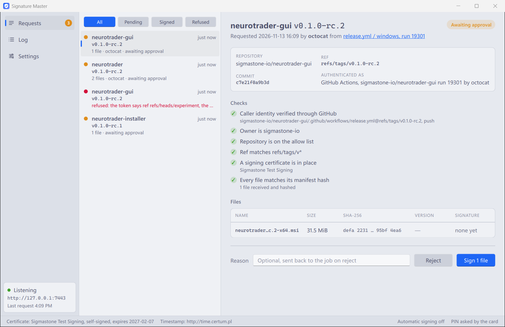

The same in the dark theme, which follows Windows (or `--color-scheme dark`).

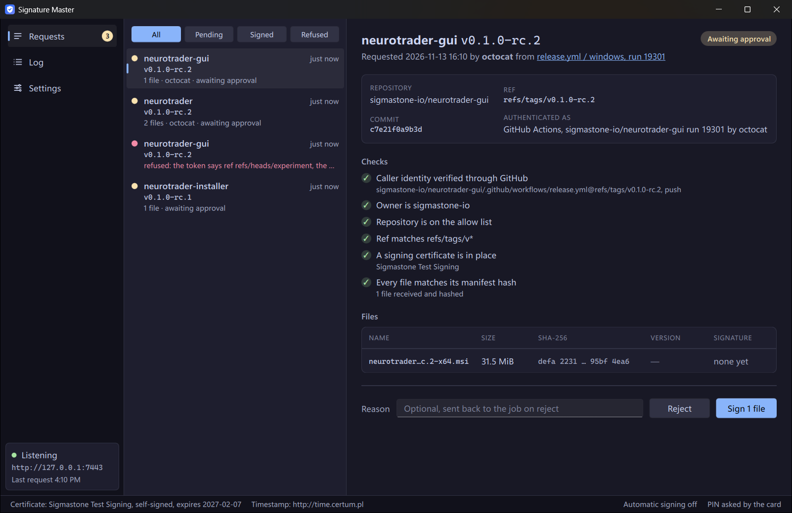

Before any job has asked: the list says where jobs reach the desk.

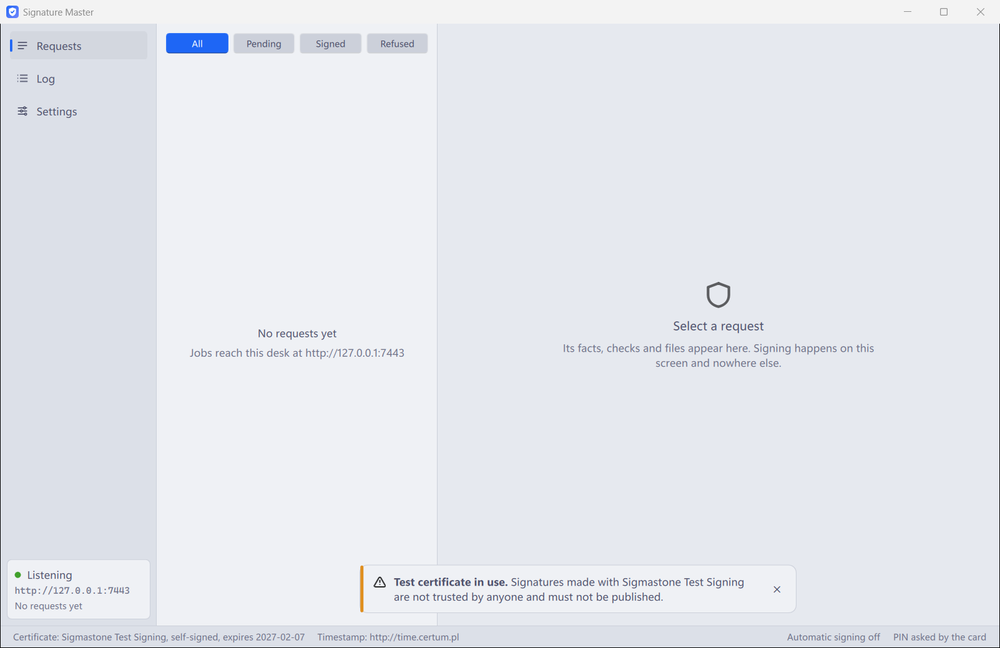

A signed request: both files signed with `signtool`, by the person at the desk.

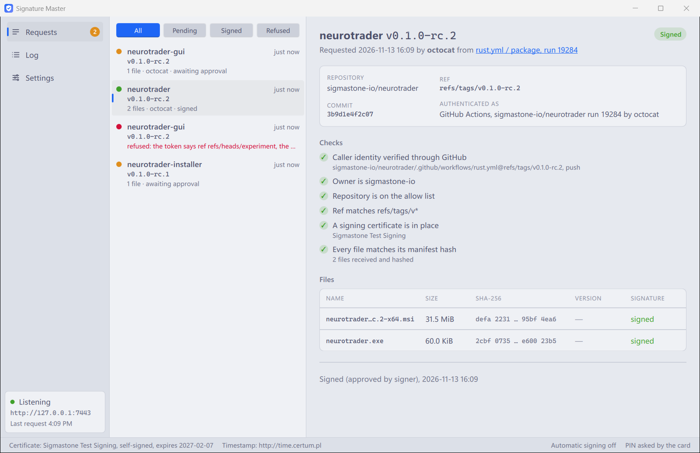

A request sent without a token, from outside GitHub Actions, rejected with a reason the job sees.

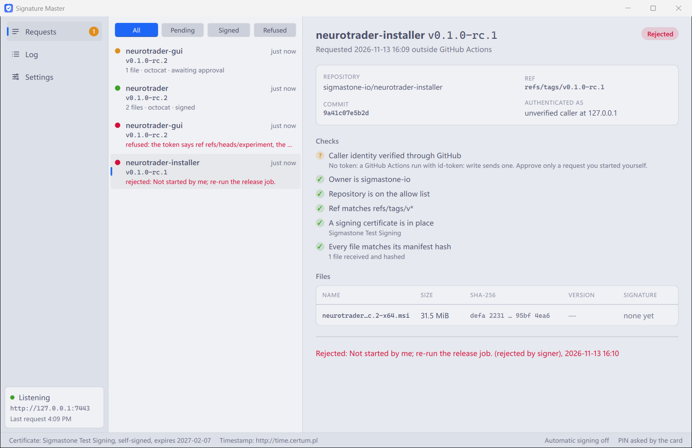

A request whose token names another ref than its manifest: refused by the checks before any file
was taken.

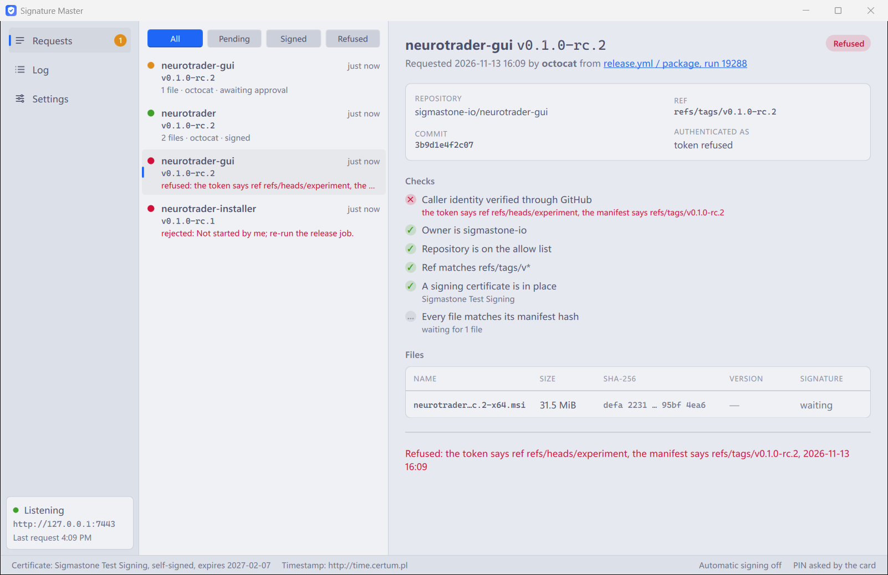

## Signature log

Every signature, refusal and rejection, one line per file, appended and never edited, with a
search, filters and CSV export.

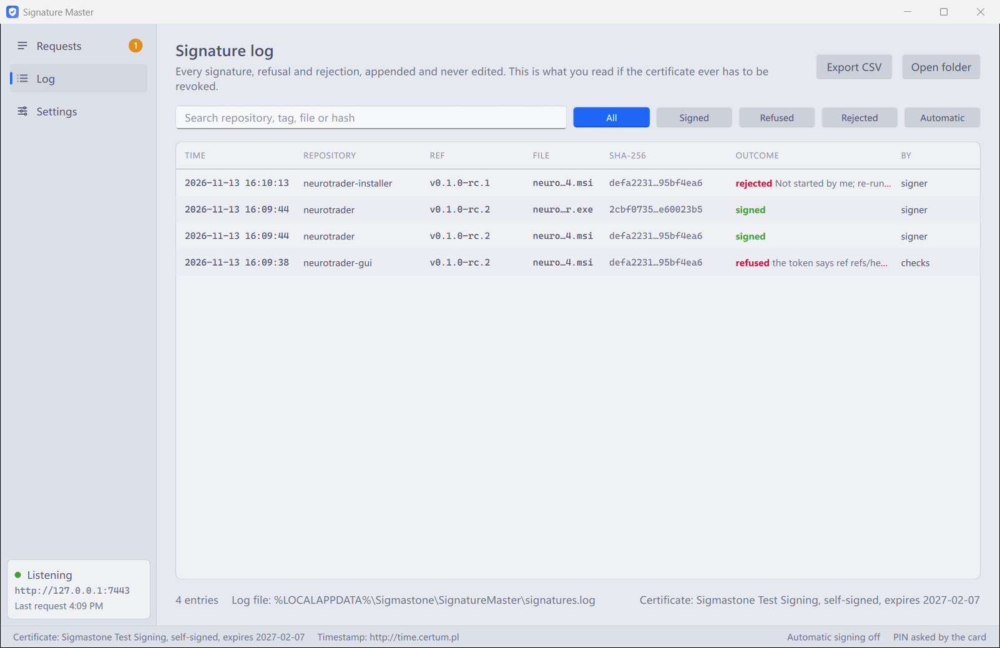

## Settings

Signing: automatic signing (off by default), the PIN setting that is not built yet, and starting
with Windows.

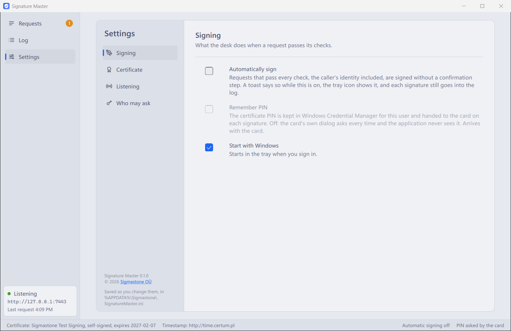

Certificate: the certificate from the user store, the timestamp server and `signtool`.

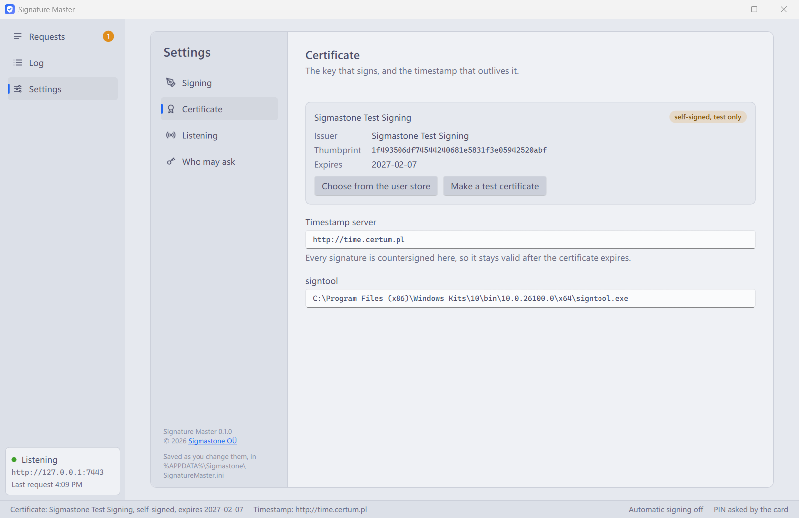

Listening: the address, the port and the work directory.

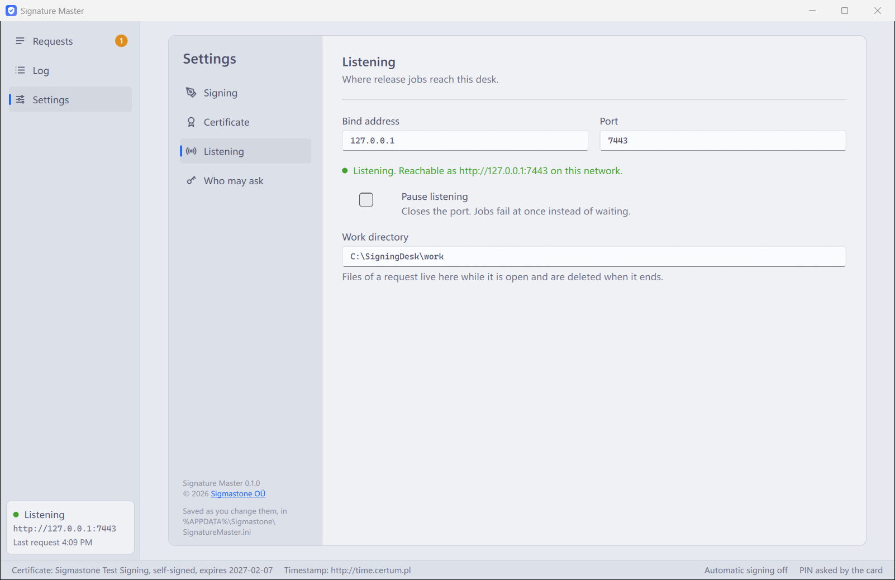

Who may ask: the GitHub owner, the repositories and the refs a request must come from.

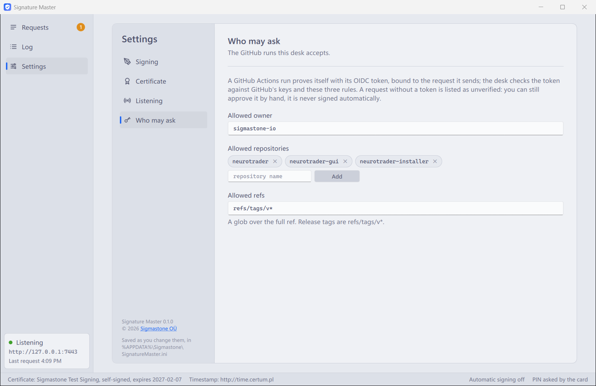

## Notices and the tray

A notice while the test certificate is in use. Notices sit at the bottom of the window until
dismissed.

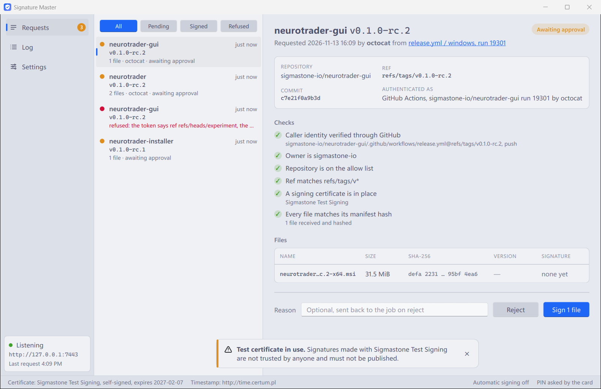

The tray menu. Closing the window hides the desk here; only Quit stops it.

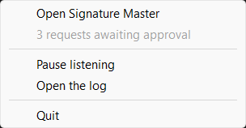
